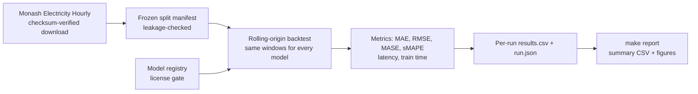

# tsfm-benchmark

[](https://github.com/Abhigyan1805/tsfm-benchmark/actions/workflows/ci.yml)


A reproducible benchmark that compares time-series foundation models (TimesFM 2.5,
Chronos-Bolt) with classical, gradient-boosting, and deep forecasters on real hourly
electricity data, measuring accuracy *and* inference cost. It is for anyone deciding
whether a pretrained forecaster is worth using over a conventional model.

## Results at a glance

Real Monash *Electricity Hourly* data, 24 series, forecast horizon 24 hours, seasonal
MASE (lower is better; 1.00 is the repeat-the-last-day floor). Source for every number:
`docs/results_summary.csv` and `REPORT.md` section 2, which also list `auto_arima`
(MASE 3.03, ~530 ms) and `naive` (4.51). Latency is the median wall-clock of one
fit + predict call, so it includes training for trained models; the TSFM and deep rows
ran on a Kaggle T4 GPU and the rest on a CPU, so latency compares hardware as well as
models.

| Model | Family | MASE (h=24) | Median latency per forecast |
| --- | --- | --- | --- |
| `chronos_bolt` | zero-shot TSFM | **0.79** | ~35 ms |
| `timesfm25` | zero-shot TSFM | 0.88 | ~122 ms |
| `seasonal_naive` | floor | 1.00 | ~0.1 ms |
| `auto_ets` | classical | 1.14 | ~177 ms |
| `xgboost_lags` | ML | 1.29 | ~104 ms |
| `lstm` / `transformer` | deep, trained from scratch | 1.75 / 1.74 | ~342 / ~600 ms |

- The zero-shot foundation models beat every trained model with no fitting on the
  target series, and the lead holds at all four horizons (24/48/96/192): Chronos-Bolt
  MASE 0.79 to 1.04, TimesFM 0.88 to 1.11, seasonal floor 1.00 to 1.30.
- The small from-scratch deep models are the negative result: behind the seasonal
  floor and among the most expensive per forecast (the Transformer is the slowest
  model, and only it and `auto_arima` are slower than the LSTM).
- These come from a bounded sample of forecast origins (see limitations below), not
  the full-stride sweep.

## How it works



Every model sits behind one `Forecaster` interface and is built through a registry that
refuses unknown or non-permissive licenses. Local models (naive, ETS/ARIMA, XGBoost) run
on CPU; the deep and zero-shot TSFM tiers ran on a Kaggle T4 GPU on the same frozen
windows. Raw per-run telemetry is committed under `docs/telemetry/`.

## Quick start

Verified on a CPU-only machine with Python 3.12. This runs the lint, the test suite, and
a tiny end-to-end backtest on the committed fixture. It needs no GPU and no credentials.

```sh
python -m venv .venv && source .venv/bin/activate
pip install -e ".[dev,models,report]"
make lint && make test
make smoke
make report   # rebuild docs/results_summary.csv + figures from the committed telemetry
```

What needs more than that:

- `python -m tsbench.data.build_catalog --materialize` (then `make backtest`) downloads
  the dataset from the network and runs the CPU families; it is slow, so it was not
  re-run for this README.
- The deep and TimesFM / Chronos-Bolt runs (`make gpu`) need a GPU and `torch`. Weight
  downloads are blocked unless `TSBENCH_ALLOW_MODEL_DOWNLOAD=1`. The Kaggle route is in
  `docs/colab-handoff.md` and needs a Kaggle account and token.
- `make report` reads both `results/` and the committed telemetry. If you have old local
  runs of the same experiment under `results/` with different configs, it stops with an
  "ambiguous results" error; remove the stale run directories.

## Limitations and honest notes

- Not deployed: this is a benchmark and research code base, with no service, users, or
  production use.
- Bounded sample: origins are taken every 240 steps (21-22 per series per horizon), not
  the manifest's 24-step stride, so the means have wider confidence intervals than the
  full sweep would. The full-stride sweep is pending.
- One dataset (24 evenly spaced series of Monash *Electricity Hourly*). The foundation
  models are pretrained on large corpora that may overlap electricity-demand structure,
  so this is not a like-for-like architecture comparison.
- The deep models are a small fixed-budget design trained from scratch at each origin
  (50 epochs, no hyper-parameter search), so their result is about that budget, not deep
  forecasting in general.
- `auto_arima` is non-seasonal, and MASE uses the rolling 168-step context as its scale
  base rather than the full training slice (details in `REPORT.md` section 1).
- CPU and GPU tiers ran on different hardware, so latency, `train_seconds`, and
  `peak_mem_mb` are only strictly comparable within a tier; `peak_mem_mb` is empty for
  the CPU tier. Latency covers fit + predict, so trained models pay their training time
  in it.
- Still pending, per `REPORT.md` section 3: the paired-statistics / critical-difference
  analysis (the `tsbench.evaluation.stats` code exists but has not been applied to these
  results) and CPU memory telemetry. The TimesFM paper-reproduction lane named in `PLAN.md`
  (E9) has no results in this repo yet.

## What I learned / design decisions

- **Same windows for everyone.** A frozen split manifest with leakage tests lets CPU and
  GPU runs be compared on identical rolling-origin windows (identical manifest digest in
  both runs).
- **Report cost, not just error.** Latency, train time, and parameter count sit next to
  MASE, so the question becomes an accuracy-vs-cost trade-off rather than one leaderboard.
- **Licenses are enforced in code.** The registry refuses entries without a license and
  revision, and refuses non-permissive licenses unless explicitly overridden; TimesFM 3.0
  was left out because its weights are non-commercial.
- **Bound the run instead of hiding it.** The 240-step stride and `track_memory: false`
  on the CPU tier (tracemalloc made `auto_arima` about 3.5x slower) are written into the
  configs and the report.
- **Telemetry is committed and checked.** Each committed run's config hash is pinned by a
  test, so the committed telemetry stays tied to the configs that produced it, and
  `make report` regenerates the summary CSV and figures from it.

## Details

**Research question:** when do time-series foundation models (TSFMs) outperform conventional forecasting models, and what is the accuracy/latency trade-off?

A reproducible, leakage-audited head-to-head of classical, ML, deep, and foundation
forecasters across forecasting horizons — measured on accuracy *and* inference cost,
with a planned partial reproduction of the TimesFM evaluation methodology (E9, pending),
producing an accuracy-vs-cost Pareto frontier rather than a single leaderboard row.

**Status:** P0 foundation, the local model tier, the GPU tier, and the data/evaluation
spine are in place — packaging, configs, the license-gated model registry, naive and
seasonal-naive floors, classical ETS/ARIMA, the XGBoost lag-feature baseline, seeded
LSTM and small Transformer forecasters plus zero-shot TimesFM 2.5 / Chronos-Bolt
wrappers behind the weight-download gate, the electricity-demand data layer with frozen
leakage-audited splits, metrics, rolling-origin backtest, results schema, paired
statistics, and CI. `make smoke` runs end-to-end on the committed fixture through the
real `naive` baseline; the full GPU tier has now run for real on Kaggle T4 through the
compute handoff in `docs/colab-handoff.md`.

**Complete benchmark results.** All five local families **and** the GPU tier (seeded
LSTM/Transformer, zero-shot TimesFM 2.5 / Chronos-Bolt) now run end-to-end on the real
Monash *Electricity Hourly* dataset over horizons 24/48/96/192, on the **same** bounded
origin sample of the frozen splits (identical split-manifest digest across both runs).
Headline numbers are in [Results at a glance](#results-at-a-glance); the full table,
figures, and the measured-vs-pending list are in [`REPORT.md`](REPORT.md) and
[`docs/results_summary.csv`](docs/results_summary.csv).

## Install and test details

The `models` extra installs the local model tier's runtime deps (`xgboost`,
`scikit-learn`, `statsforecast`, `statsmodels`); without it the tier's tests skip.
The `report` extra adds `matplotlib` for the figures (it is also in `dev`, so CI
exercises the report script).

```sh
python -m venv .venv
source .venv/bin/activate
pip install -e ".[dev,models,report]"
make test
make lint
```

## Make targets

| Target | What it does |
| --- | --- |
| `make test` | run the pytest suite |
| `make lint` | run ruff |
| `make smoke` | tiny end-to-end run: `python -m tsbench run --config configs/experiments/smoke.yaml` over `tests/fixtures/smoke_series.csv` through the `local_csv` loader |
| `make data` | fetch and checksum-verify the dataset catalogue (`python -m tsbench.data.build_catalog --materialize`; see `data/manifests/PROVENANCE.md`) |
| `make backtest` | 24h rolling-origin backtest, all five local families (`configs/experiments/backtest.yaml`); bounded origin stride, see `REPORT.md` |
| `make horizons` | complete the primary sweep at 48/96/192 on the same frozen boundaries (`configs/experiments/backtest_h{48,96,192}.yaml`) |
| `make gpu` | deep LSTM/Transformer + zero-shot TimesFM 2.5/Chronos-Bolt on the CPU families' frozen windows (`configs/experiments/gpu.yaml`; run in a GPU session via `docs/colab-handoff.md`) |
| `make gpu-horizons` | remaining GPU-tier horizons (`configs/experiments/gpu_h{48,96,192}.yaml`) |
| `make report` | merge the live `results/` store with the committed `docs/telemetry/` store and regenerate `docs/results_summary.csv` + `docs/figures/` (`scripts/make_plots.py`) |
| `make licenses` | print the model license manifest from `configs/models.yaml` |
| `make reproduce` | rerun the documented end-to-end path |

Experiment stages are dispatched through `python -m tsbench run --config <experiment.yaml>`;
dataset materialization runs through `python -m tsbench.data.build_catalog --materialize`,
and configs for later phases land with their slices. CI runs the same commands the
quickstart does: `ruff check .` and `python -m pytest`.

## Frozen interfaces

`src/tsbench/base.py` is the fleet-wide contract that the data, model, and
evaluation slices build against:

- `Forecaster` protocol — `.name`, `.fit(y) -> self`, `.predict(h) -> np.ndarray`,
  `.info() -> ModelInfo`
- `ModelInfo(name, family, zero_shot, params, license, revision, extra)` — `extra`
  optionally carries engine/backend details; `zero_shot` marks forecasters with no
  learned parameters (reference floors and untuned TSFMs)
- `RESULT_COLUMNS` — every result row carries those columns in that exact order.
  `train_seconds` sits immediately after `peak_mem_mb`; it is the measured fit/train
  wall-clock for families that train or fit (classical, ML, deep) and is left empty
  only for the `baseline` and zero-shot `tsfm` families.

The experiment runner is resolved from `tsbench.evaluation.runner.run_experiment`
and called with the experiment config path. The registry is
`tsbench.registry.load_registry`; `ModelRegistry.instantiate` is the only public
construction path and every call passes the license gate.

A config-declared `entrypoint` for a name the registry does not know is the
documented way to benchmark your own forecaster. It is refused unless the run
explicitly opts in with `TSBENCH_ALLOW_UNREGISTERED=1` (or
`run --allow-unregistered`), and the config must declare the model's `family`
and a non-empty `license`; a missing license, or one outside the permissive
allowlist, is refused exactly as for a registered model. The declared family
and license are recorded in `run.json` under `unregistered_models`; the config
key is stamped as the row's `model` and the declared family as its `family`, so
an unregistered result carries its provenance instead of only asserting it.
`make report` surfaces that provenance in `docs/results_summary.csv` as the
`unregistered` flag and the `unregistered_license` column (false and empty
respectively for registry-backed rows), and marks the same rows in the figures.
Registry-known names still pass the gate (their not-yet-landed fallback calls
`check_license` before importing the config entrypoint), and the TSFM wrappers
still refuse unverified checkpoint ids through the fallback.

## Models and the license gate

`configs/models.yaml` declares nine keys: `naive`, `seasonal_naive`, `auto_ets`,
`auto_arima`, `xgboost_lags`, `lstm`, `transformer`, `timesfm25`, `chronos_bolt`.
Each entry must declare `entrypoint`, `family`, `zero_shot`, `license`, and
`revision`; an entry missing a license or revision is refused at load time.
Instantiation is refused for any license outside the explicit permissive allowlist
(Apache-2.0, MIT, BSD-2-Clause, BSD-3-Clause, ISC, 0BSD, Unlicense, CC0-1.0,
CC-BY-4.0) unless `TSBENCH_ALLOW_NONCOMMERCIAL=1` (or `run --allow-noncommercial`)
is set. `TBD-at-download` marks a revision pinned at fetch time; `make licenses`
prints the manifest revision for every key. The results schema does not carry a
revision column. TimesFM 2.5 (Apache-2.0) is in scope; TimesFM 3.0 weights are
non-commercial and deliberately out of scope.

## Environment variables

| Variable | Effect |
| --- | --- |
| `TSBENCH_ALLOW_NONCOMMERCIAL=1` | instantiate non-permissive or unknown-license models |
| `TSBENCH_ALLOW_UNREGISTERED=1` | run a config-declared model whose name is not in the registry (requires a declared `family` and `license`) |
| `TSBENCH_ALLOW_MODEL_DOWNLOAD=1` | permit TSFM weight downloads (GPU slice gate) |
| `TSBENCH_RESULTS_DIR` | override the results root (default `results/`) |

## Layout

```
configs/models.yaml            model keys, entrypoints, licenses, revisions
configs/experiments/           smoke, backtest/gpu (24h), backtest_h{48,96,192}, gpu_h{48,96,192}, gpu_probe/pilot
src/tsbench/base.py            frozen contract: Forecaster, ModelInfo, RESULT_COLUMNS
src/tsbench/registry.py        manifest validation + license-gated factory
src/tsbench/cli.py             python -m tsbench run|licenses
src/tsbench/data/              dataset loaders and splits (data slice)
src/tsbench/models/            model implementations (model and GPU slices)
src/tsbench/evaluation/        metrics, backtest, stats, results, runner (data slice)
scripts/make_plots.py          telemetry store -> summary CSV + figures (make report)
scripts/kaggle_run.py          resumable Kaggle GPU batch route (see docs/colab-handoff.md)
docs/telemetry/{cpu,gpu}/      committed per-run raw telemetry (results.csv + run.json)
docs/results_summary.csv       committed per-family per-horizon summary (real numbers)
docs/figures/                  committed MASE and accuracy-vs-cost figures
REPORT.md                      setup, results, measured-vs-pending, limitations
tests/                         pytest suite and the smoke fixture
```

See `PLAN.md` for the condensed plan of record: scope, experiment matrix,
phases, risks, and deliverables.
